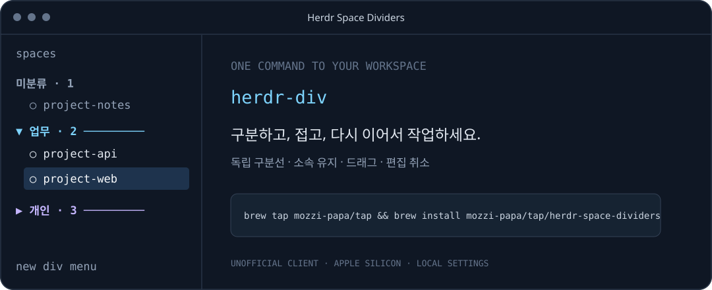
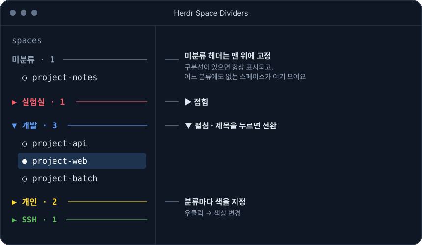
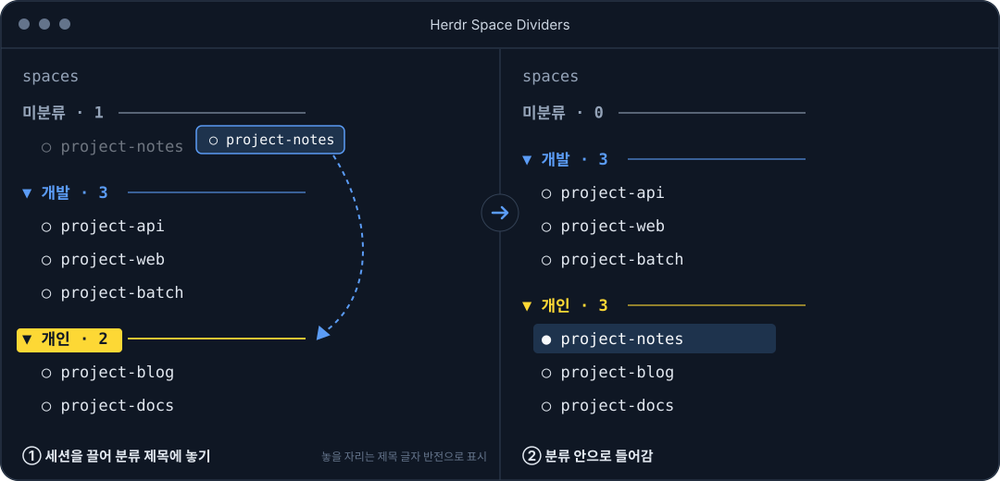
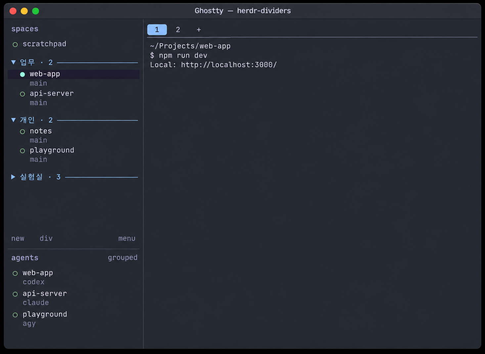

# Herdr Space Dividers

**작업 공간을 분류하고, 필요한 공간만 펼쳐서 사용하세요.**

Herdr의 `spaces`에 구분선·분류·접기·드래그를 더하는 비공식 클라이언트입니다.

**Apple Silicon · Herdr 0.9.5 · 패키지 0.1.3 · 도구 MIT / 패치 Apache-2.0**



[설치](#설치) · [사용법](docs/USAGE.md) · [업데이트](docs/UPDATING.md) · [안전장치](docs/SAFETY.md) · [검증 기록](docs/VERIFICATION.md)

## 설치

```sh
brew tap mozzi-papa/tap && brew install mozzi-papa/tap/herdr-space-dividers
herdr-div
```

공식 Herdr의 기본 로컬 서버가 필요합니다. Herdr 안에 있다면 `Ctrl+B`, `q`로 화면만 분리한 뒤 실행하세요.

| 명령 | 실행되는 것 |
|---|---|
| `command herdr` | 순정 Herdr |
| `herdr-div` | div(구분선)가 추가된 버전 |

두 명령은 같은 서버를 쓰므로 작업은 그대로 이어지고, 순정 `herdr` 명령은 바꾸지 않습니다.

## 미분류와 드래그

구분선이 있으면 목록 맨 위에 `미분류 · N` 헤더가 고정되고, 분류마다 색을 지정할 수 있습니다.



스페이스를 분류 제목으로 끌어 놓으면 소속이 옮겨집니다.



## 기능

| 기능 | 사용 방법 |
|---|---|
| 구분선 만들기 | 목록 하단 `div` 클릭 후 제목 입력 |
| 접기·펼치기 | 구분선 제목 클릭. 접어도 실행 중인 작업은 계속 동작 |
| 분류 이동 | 구분선 드래그로 분류 통째 이동, 스페이스 드래그로 소속 변경 |
| 이름·색·삭제 | div 우클릭 |

숫자 이동, 저장 위치 같은 자세한 내용은 [사용법](docs/USAGE.md)을 참고하세요.



## 업데이트

```sh
brew upgrade mozzi-papa/tap/herdr-space-dividers
```

`menu`에 현재 버전이 표시되고, 새 버전이 있으면 알려 줍니다. 자세한 내용은 [사용법](docs/USAGE.md#버전-표시와-업데이트-알림)을 참고하세요.

## 문제가 생기면

`command herdr`로 순정 Herdr를 실행하세요. 작업은 서버에 그대로 남아 있습니다. 서버 확인과 재시작 순서는 [사용법](docs/USAGE.md#문제가-생겼을-때-순정-herdr로-실행)에 있습니다.

## 지원 범위

| 항목 | 범위 |
|---|---|
| 배포 대상 | Apple Silicon / macOS 15 이상 |
| 기반 Herdr | 0.9.5 |
| 세션 | 기본 경로의 기본 로컬 세션 |

다른 맥, Intel·Linux·Windows, 다중 머신 목록, 이후 Herdr 버전은 확인하지 않았습니다. Developer ID 서명과 Apple 공증은 받지 않았습니다. 검증 범위는 [검증 기록](docs/VERIFICATION.md), 파일 변경과 복구 범위는 [안전 안내](docs/SAFETY.md)에 있습니다.

<details>
<summary><strong>개발자용: 소스에서 빌드하기</strong></summary>

```sh
git clone https://github.com/mozzi-papa/herdr-space-dividers.git
cd herdr-space-dividers
sh update-custom.sh 0.9.5
sh run.sh
```

필요한 도구와 업데이트·복구는 [개발자용 업데이트 안내](docs/UPDATING.md), 릴리스 절차는 [RELEASING](docs/RELEASING.md)을 참고하세요.

</details>

## 라이선스

도구와 문서는 MIT, Herdr 기반 패치는 Apache-2.0입니다. [라이선스 범위](docs/LICENSING.md)

## English

Unofficial Herdr workspace dividers for Apple Silicon macOS. Install with `brew tap mozzi-papa/tap && brew install mozzi-papa/tap/herdr-space-dividers`, then run `herdr-div` outside Herdr. It attaches to your existing default local Herdr server; the official `herdr` command is unchanged. Run the stock Herdr anytime with `command herdr` (it bypasses shell functions and aliases); your sessions stay on the server. Package 0.1.3 targets Herdr 0.9.5. Tools and docs are MIT, the patch is Apache-2.0. Not affiliated with Herdr and not Developer ID signed or notarized.
