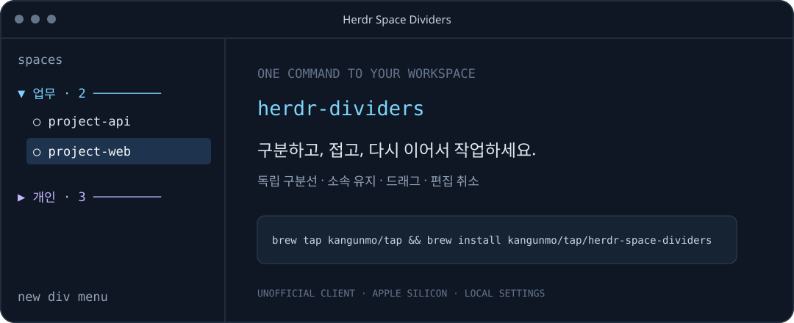
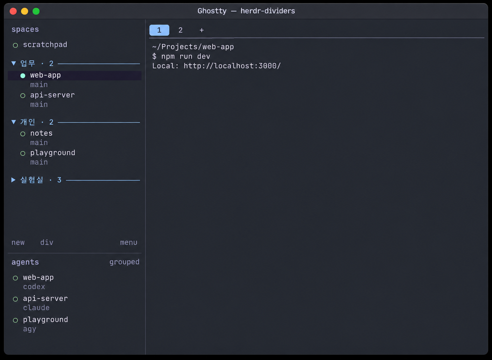

# Herdr Space Dividers

**작업 공간을 분류하고, 필요한 공간만 펼쳐서 사용하세요.**

Herdr의 `spaces`에 구분선·분류·접기·드래그를 더하는 비공식 클라이언트입니다.

**Apple Silicon · Herdr 0.9.5 · 패키지 0.1.0 · 도구 MIT / 패치 Apache-2.0**



*개인 정보가 없는 기능 구성 예시입니다. 실제 사용자 화면 캡처가 아닙니다.*

[설치](#설치) · [사용법](docs/USAGE.md) · [업데이트](docs/UPDATING.md) · [안전장치](docs/SAFETY.md) · [검증 기록](docs/VERIFICATION.md)

## 설치

Homebrew와 공식 Herdr의 **기본 로컬 서버**를 준비해 주세요.

```sh
brew install kangunmo/tap/herdr-space-dividers
```

빌드된 실행 파일을 설치하므로 사용자에게 Rust·Zig·Python은 필요하지 않습니다.

```sh
herdr-dividers
```

이미 Herdr 안에 있다면 기본 설정의 `Ctrl+B`, `q`로 화면만 분리한 뒤 실행해 주세요. 기존 `herdr` 명령과 작업 서버는 그대로 유지합니다. 서버가 없다면 먼저 공식 `herdr`를 실행해 주세요.

> 개인 Homebrew tap으로 배포하는 비공식 클라이언트입니다. Herdr 또는 Homebrew의 공식 인증·검토를 받은 제품으로 표시하지 않습니다.

## Ghostty 활용 예시

업무·개인 작업을 분류하고, 사용하지 않는 실험실 분류는 접어 두는 구성입니다. 각 분류 안의 스페이스는 들여쓰기로 구분하며, 아래 `agents` 목록에서 에이전트 상태를 확인할 수 있습니다.



*실제 화면 배치를 참고해 AI로 재구성한 예시이며 실제 캡처는 아닙니다. 프로젝트명·경로·에이전트 목록은 모두 가상 데이터입니다.*

## 목록은 원하는 분류로

| 기능 | 사용 방법 |
|---|---|
| 제목이 있는 구분선 | 목록 하단 `div` 클릭 후 제목 입력 |
| 접기·펼치기 | 구분선 제목 클릭 |
| 분류 소속 유지 | 스페이스 ID를 저장하여 추가·삭제 시 기존 소속 보존 |
| 위치·분류 편집 | 구분선 또는 스페이스 드래그 |
| 구분선 편집 | div 우클릭으로 이름 변경·삭제·편집 취소 |
| 프로젝트 폴더 | 스페이스 우클릭으로 폴더 열기·경로 복사 |

구분선은 셸이나 에이전트를 만들지 않으며 숫자 이동 대상에서도 제외합니다. 접힌 스페이스를 단축키로 선택하면 펼쳐집니다. **접어도 실행 중인 작업은 계속 동작합니다.**

숫자 이동 설정, 드래그 경계의 의미와 저장 위치는 [상세 사용법](docs/USAGE.md)을 참고해 주세요.

## 업데이트도 Homebrew로

```sh
brew upgrade kangunmo/tap/herdr-space-dividers
```

```sh
herdr-dividers --version
herdr-dividers --help
```

검증한 패키지 릴리스를 설치하는 방식입니다. 공식 Herdr가 업데이트되었다고 이 패치에 자동으로 병합되는 것은 아닙니다. 각 릴리스가 지원하는 Herdr 버전을 확인해 주세요. 기존 구분 설정은 디버그·릴리스 빌드 모두 같은 JSON 경로에서 읽습니다.

## 검증 내용을 공개합니다

배포 전에 클라이언트 테스트, 별도 임시 서버의 마우스·저장·재접속 검증, 실행 파일·라이선스 고지·개인 경로 검사를 수행합니다. 다운로드 파일은 SHA-256으로 대조할 수 있습니다.

- **기존 작업 유지:** 기존 서버를 자동 종료하거나 공식 실행 파일을 교체하지 않습니다.
- **설정 유지:** 제목·소속·접기 상태를 기존 클라이언트 JSON에 저장합니다.
- **과장 없는 범위:** 실제 검사 환경과 확인하지 않은 항목을 [검증 기록](docs/VERIFICATION.md)에 구분합니다.

Homebrew 설치는 이미 검증한 파일을 가져오는 방식이며, 사용자 맥에서 전체 소스 테스트를 다시 실행하지 않습니다. 자세한 파일 변경·백업·복구 범위는 [안전 안내](docs/SAFETY.md)를 확인해 주세요.

## 지원 범위

| 항목 | 범위 |
|---|---|
| 배포 대상 | Apple Silicon / macOS 15 이상 |
| 실행 확인 | M2 Max / macOS 26.3.1 |
| 기반 Herdr | 0.9.5 |
| 세션 | 기본 경로의 기본 로컬 세션, 펼친 단일 머신 사이드바 |
| 설정 | `~/.local/state/herdr-dev/client-shell/`의 기존 JSON (`XDG_STATE_HOME` 지원) |

다른 맥에서의 실제 설치, Intel·Linux·Windows, 다중 머신 통합 목록과 미래 Herdr 버전은 별도 확인이 필요합니다. 릴리스 파일의 ad-hoc 서명은 Apple Developer ID 신원 확인이나 Apple 공증을 뜻하지 않습니다.

<details>
<summary><strong>개발자용: 소스에서 빌드하기</strong></summary>

소스 빌드는 Rust 1.96.1과 rustfmt, Zig 0.16.0, Python 3.11 이상과 tar 추출 필터, macOS 개발 도구, patch·curl이 필요합니다.

```sh
git clone https://github.com/KangUnMo/herdr-space-dividers.git
cd herdr-space-dividers
sh update-custom.sh 0.9.5
sh run.sh
```

Zig가 PATH에 없다면 `ZIG`에 실행 파일의 절대 경로를 지정해 주세요. 빌드와 검증에는 시간이 걸리고 디스크 공간을 사용합니다.

소스 빌드의 업데이트·백업·`--rollback`은 [개발자용 업데이트 안내](docs/UPDATING.md)를 참고해 주세요. 이 스크립트의 복구는 Homebrew 패키지의 복구 명령이 아닙니다.

```sh
python3 -m unittest discover -s tools -p 'test_*.py' -v
```

[릴리스 준비 절차](docs/RELEASING.md)는 개발자용 문서입니다.

</details>

## 누구나 사용하고 개선할 수 있습니다

독립 도구·문서는 **MIT**, Herdr 기반 패치는 **Apache-2.0**입니다. 각 라이선스 조건을 유지하며 사용·수정·재배포할 수 있습니다. 바이너리에 사용된 제삼자 고지도 함께 제공합니다. [라이선스 범위](docs/LICENSING.md)

재현 가능한 문제 보고와 코드·문서 개선을 환영합니다. 보고에는 버전과 필요한 오류만 포함해 주세요. 설정·백업·전체 로그에는 개인 정보가 있을 수 있습니다.

## English

Unofficial Herdr workspace dividers for Apple Silicon macOS. Install with `brew install kangunmo/tap/herdr-space-dividers`, then run `herdr-dividers` outside Herdr. No Rust, Zig or Python is required for the prebuilt package. It attaches to your existing default local Herdr server without replacing the official command. Package 0.1.0 targets Herdr 0.9.5. Independent tools/docs are MIT; the patch is Apache-2.0. Third-party notices are bundled. Not affiliated with Herdr, not Developer ID signed/notarized, and not a guarantee of future compatibility.
